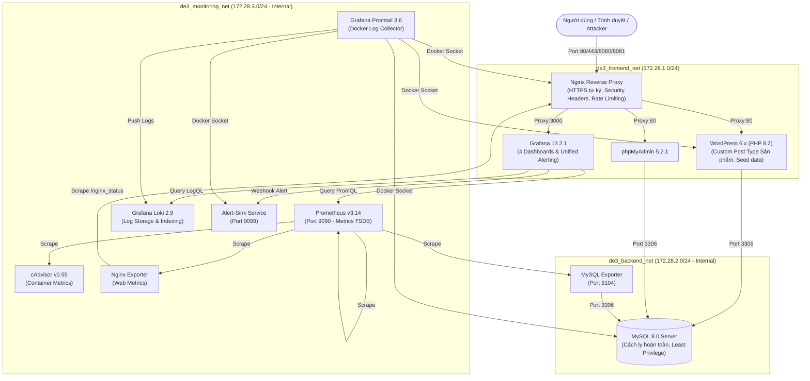

# BÀI TẬP LỚN: TRIỂN KHAI VÀ QUẢN TRỊ HỆ THỐNG PHẦN MỀM
## ĐỀ TÀI 3: WEBSITE QUẢNG BÁ SẢN PHẨM (WORDPRESS)

- **Sinh viên thực hiện:** Lương Việt Anh
- **Mã số sinh viên (MSSV):** DTC245200063
- **Lớp:** CNTT K23B
- **Khoa:** Công nghệ Thông tin - Trường Đại học Công nghệ Thông tin & Truyền thông (ICTU)
- **Repository GitHub:** [https://github.com/dtc245200063-alt/DTC245200063](https://github.com/dtc245200063-alt/DTC245200063)

---

## 1. TỔNG QUAN HỆ THỐNG VÀ KIẾN TRÚC

Hệ thống được thiết kế theo tiêu chuẩn DevOps & Production-Ready, đóng gói hoàn chỉnh bằng Docker Compose với mô hình phân vùng mạng 3 lớp (3-Tier Network Architecture):



---

## 2. BẢNG DỊCH VỤ, CỔNG VÀ TÀI KHOẢN TRUY CẬP

| Dịch vụ | Địa chỉ URL (HTTPS chính thức) | Địa chỉ URL (Host Forwarding) | Tài khoản / Mật khẩu |
|---|---|---|---|
| **Website WordPress** | `https://192.168.102.128/` | `http://localhost:8080/` | Khách vãng lai xem sản phẩm |
| **Cổng quản trị WP** | `https://192.168.102.128/wp-admin/` | `http://localhost:8080/wp-admin/` | Quản trị: `quantri` / *(Xem `.env`)*<br/>Biên tập: `bientap01` / *(Xem `.env`)* |
| **phpMyAdmin** | `https://192.168.102.128/phpmyadmin/` | `http://localhost:8080/phpmyadmin/` | User DB: `wp_app` / *(Xem `.env`)* |
| **Grafana Dashboard** | `https://192.168.102.128/grafana/` | `http://localhost:8080/grafana/` | Admin: `admin` / *(Xem `.env`)* |
| **Prometheus API** | `http://prometheus:9090` *(Nội bộ)* | Tunnel: `ssh -L 9090:localhost:9090 vanh@192.168.102.128` | Truy cập an toàn qua SSH Tunnel |

> **Lưu ý bảo mật:** Mật khẩu thực tế được sinh ngẫu nhiên mạnh và lưu trữ an toàn trong tệp `.env` (đã phân quyền `chmod 600`, không commit lên GitHub).

---

## 3. HƯỚNG DẪN CHẠY ĐÚNG THỨ TỰ

### 3.1. Yêu cầu hệ thống
- Hệ điều hành: Linux Ubuntu 22.04 / 24.04 LTS (hoặc máy ảo VMware/VirtualBox).
- Bộ nhớ RAM: Tối thiểu 4 GB RAM.
- Dung lượng ổ cứng: Tối thiểu 15 GB trống.
- Đã cài đặt: `docker.io`, `docker-compose-v2`, `openssl`, `curl`, `git`, `ufw`.

### 3.2. Trình tự các bước triển khai chuẩn hóa

Triển khai hệ thống trên máy chủ Ubuntu theo trình tự chuẩn hóa các bước dưới đây:

```bash
# Bước 1: Sao chép mã nguồn dự án từ GitHub
git clone https://github.com/dtc245200063-alt/DTC245200063.git

# Bước 2: Di chuyển vào thư mục dự án
cd DTC245200063

# Bước 3: Tạo file cấu hình biến môi trường và điền mật khẩu
cp .env.example .env
chmod 600 .env
nano .env # Cấu hình các giá trị mật khẩu bí mật an toàn

# Bước 4: Tự động khởi tạo chứng chỉ SSL tự ký cho Nginx HTTPS
./nginx/gen-cert.sh 192.168.102.128

# Bước 5: Khởi chạy toàn bộ hệ thống dịch vụ bằng Docker Compose
docker compose up -d --build

# Bước 6: Cài đặt tự động WordPress và nạp 12 sản phẩm mẫu bằng WP-CLI
docker compose --profile tools run --rm --entrypoint /bin/sh wpcli /scripts/install.sh

# Bước 7: Kiểm tra trạng thái toàn bộ 12 container hoạt động bình thường
docker compose ps
```

---

## 4. HƯỚNG DẪN SỬ DỤNG THEO VAI TRÒ

### 4.1. Vai trò Khách hàng / Người dùng thông thường
- Truy cập `https://192.168.102.128/` xem banner quảng bá và sản phẩm nổi bật.
- Mở danh mục **Sản phẩm** (`/san-pham/`) để duyệt danh sách 12 đặc sản chè và cà phê Việt Nam (lọc theo danh mục: Trà đặc sản, Cà phê nguyên chất, Bánh mứt truyền thống).
- Nhấp vào từng sản phẩm để xem trang chi tiết: giá bán, nguồn gốc xuất xứ, mô tả hương vị.
- Đọc bài viết tại mục **Tin tức** (`/tin-tuc/`) và gửi thông tin phản hồi tại form **Liên hệ** (`/lien-he/`).

### 4.2. Vai trò Biên tập viên (`bientap01`)
- Đăng nhập tại `https://192.168.102.128/wp-login.php`.
- Quyền hạn: Thêm, sửa, đăng bài viết tin tức và sản phẩm mới; quản lý bình luận. Không có quyền can thiệp vào plugin, theme hay cấu hình hệ thống.

### 4.3. Vai trò Quản trị viên (`quantri`)
- Quyền hạn: Toàn quyền cấu hình trang web, quản lý tài khoản người dùng, xem log bảo mật.
- Bị khóa tính năng sửa code theme/plugin trực tiếp trên giao diện (`DISALLOW_FILE_EDIT=true`) nhằm phòng chống webshell.

---

## 5. HƯỚNG DẪN GIÁM SÁT VÀ TRUY VẾT LOG

### 5.1. Xem 4 Dashboard giám sát trên Grafana
Truy cập `https://192.168.102.128/grafana/` (hoặc `http://localhost:8080/grafana/`):
1. **`WP - Containers`:** Giám sát mức tiêu thụ CPU, RAM, Network I/O và trạng thái sức khỏe của từng container.
2. **`WP - Nginx`:** Giám sát lưu lượng HTTP request/s, số lượng active connections, handled/accepted connections.
3. **`WP - MySQL`:** Giám sát số queries/s, threads connected, threads running và bộ nhớ đệm InnoDB Buffer Pool.
4. **`WP - Logs`:** Giám sát luồng log tập trung của WordPress, thống kê mã HTTP Nginx, đếm lỗi `LOGIN_FAILED` và lưu lượng vào `/wp-login.php`.

### 5.2. Các câu truy vấn LogQL chuẩn trong Grafana Explore
1. **Lỗi HTTP 5xx của Nginx:**
   ```logql
   {job="nginx"} |~ "\" 5[0-9]{2} "
   ```
2. **Lỗi / Ngoại lệ ứng dụng WordPress:**
   ```logql
   {job="webapp"} |~ "(?i)(error|exception|failed|fatal)"
   ```
3. **Danh sách các lần đăng nhập thất bại:**
   ```logql
   {job="webapp"} |= "LOGIN_FAILED"
   ```
4. **Đo lường tần suất đăng nhập sai theo phút:**
   ```logql
   sum(count_over_time({job="webapp"} |= "LOGIN_FAILED" [1m]))
   ```
5. **Số lượng request POST tới trang đăng nhập WordPress:**
   ```logql
   sum(count_over_time({job="nginx"} |= "POST /wp-login.php" [1m]))
   ```

---

## 6. KỊCH BẢN SỰ CỐ AN TOÀN THÔNG TIN & ALERTING

### 6.1. Mô tả sự cố Brute-force
Kẻ tấn công thực hiện quét từ điển liên tiếp vào `/wp-login.php` nhằm chiếm đoạt tài khoản quản trị `quantri`.

### 6.2. Thực thi kịch bản và quan sát cảnh báo
Chạy kịch bản tự động được chuẩn bị sẵn:
```bash
./scripts/simulate_bruteforce.sh
```
**Quy trình phản ứng của hệ thống:**
1. Kịch bản gửi liên tiếp 20 request đăng nhập sai mật khẩu.
2. WordPress hook bắt sự kiện ghi log ra stderr: `LOGIN_FAILED ip=... user=quantri reason=wrong_password`.
3. Promtail đẩy log về Loki theo thời gian thực.
4. Grafana Alert Rule `WP - Brute force login` phát hiện `LOGIN_FAILED > 5` trong 1 phút, lập tức kích hoạt trạng thái **FIRING**.
5. Cảnh báo được gửi qua Webhook tới container `alert-sink` (`http://alert-sink:9099/alert`) và ghi nhận vào `/data/alerts.log`.
6. Báo cáo phân tích sự cố chi tiết được lưu tại `docs/su-co-bruteforce.md`.

---

## 7. CÁC BIỆN PHÁP GIA CỐ BẢO MẬT (HARDENING)

Hệ thống đã triển khai đầy đủ 7 biện pháp gia cố bảo mật chuyên sâu:
1. **Network Isolation (3 Phân vùng mạng):** Tách `frontend_net`, `backend_net` (internal), `monitoring_net` (internal). MySQL được cô lập tuyệt đối trong backend.
2. **Container Non-Root & Capabilities Drop:** Toàn bộ container chạy người dùng không đặc quyền (`nobody`, `grafana`, `loki`, `1000`), gỡ bỏ `ALL` capabilities và kích hoạt `no-new-privileges:true`.
3. **Least Privilege Database:** User `wp_app` chỉ có quyền thao tác trên schema `wordpress.*`. Thu hồi toàn bộ quyền quản trị bảng hệ thống.
4. **Nginx Rate Limiting:** Áp dụng `limit_req_zone` 10 request/phút (burst 5) cho `/wp-login.php`, trả về **HTTP 429** khi bị tấn công.
5. **Chống dò quét người dùng (Anti-Enumeration):** Chặn tham số `/?author=N` và chặn REST API endpoint `/wp-json/wp/v2/users` (trả về **HTTP 403**).
6. **Ẩn thông tin phiên bản:** Bật `server_tokens off`, cấu hình `proxy_hide_header X-Powered-By;`, loại bỏ meta generator và query string `?ver=`.
7. **Tường lửa UFW:** Kích hoạt tường lửa máy chủ với chính sách mặc định chặn toàn bộ incoming, chỉ cho phép cổng 22, 80, 443, 8080, 8081.

Tất cả các biện pháp được áp dụng và xác minh tự động bằng script:
```bash
./scripts/apply_hardening.sh
```

---

## 8. QUẢN TRỊ VÀ XỬ LÝ SỰ CỐ THƯỜNG GẶP

### 8.1. Dừng và khởi động lại hệ thống
```bash
# Tạm dừng toàn bộ dịch vụ (giữ nguyên dữ liệu)
docker compose stop

# Khởi động lại
docker compose up -d

# Xóa container nhưng giữ nguyên dữ liệu volumes
docker compose down

# Xóa sạch toàn bộ container và dữ liệu volumes để cài lại từ đầu
docker compose down -v
```

### 8.2. Trình duyệt cảnh báo chứng chỉ SSL tự ký
Do chứng chỉ SSL được sinh tự ký (Self-signed) cho IP máy ảo nội bộ, khi truy cập `https://192.168.102.128/`:
- Trên Chrome / Edge: Nhấp vào **Nâng cao (Advanced)** -> Chọn **Tiếp tục truy cập (Proceed to 192.168.102.128 - unsafe)**.
- Hoặc gõ trực tiếp cụm từ `thisisunsafe` trên cửa sổ trình duyệt.

### 8.3. Khi máy ảo bị đổi địa chỉ IP (DHCP)
Nếu máy ảo đổi sang IP mới (ví dụ `192.168.102.130`):
1. Cập nhật biến `SERVER_IP=192.168.102.130` trong file `.env`.
2. Chạy lại script sinh chứng chỉ mới: `./nginx/gen-cert.sh 192.168.102.130`.
3. Khởi động lại Nginx: `docker compose restart nginx`.
Website sẽ tự động nhận diện IP mới nhờ cơ chế sinh URL động qua header Reverse Proxy.

---

## 9. CẤU TRÚC THƯ MỤC DỰ ÁN

```text
De3_DTC245200063/
├── .env.example                                # Tệp mẫu biến môi trường (không chứa secret)
├── .gitignore                                  # Danh sách tệp loại trừ khỏi Git (.env, *.key, evidence/)
├── docker-compose.yml                          # Tệp cấu hình Docker Compose chính (12 services, 3 networks)
├── README.md                                   # Hướng dẫn chi tiết hệ thống
├── alert-sink/                                 # Dịch vụ tiếp nhận cảnh báo Webhook
│   ├── Dockerfile
│   └── server.py
├── db/                                         # Khởi tạo cơ sở dữ liệu
│   └── init.sql
├── docs/                                       # Tài liệu kỹ thuật
│   ├── su-co-bruteforce.md                     # Báo cáo phân tích sự cố an toàn thông tin
│   └── cho-bao-cao.md                          # Tài liệu tổng hợp phục vụ viết báo cáo BTL
├── evidence/                                   # Bằng chứng thực nghiệm (được gitignore)
│   ├── buoc0-moitruong.txt
│   ├── buoc12-wordpress-db.txt
│   ├── buoc3-nginx.txt
│   ├── buoc4-giamsat.txt
│   ├── buoc5-logql.txt
│   ├── buoc5-sucodo.txt
│   ├── buoc6-hardening.txt
│   └── final-smoke-test.txt
├── grafana/                                    # Cấu hình Grafana Provisioning
│   └── provisioning/
│       ├── alerting/                           # Quy tắc cảnh báo & Contact points
│       │   ├── contact-points.yaml
│       │   ├── policies.yaml
│       │   └── rules.yaml
│       ├── dashboards/                         # 4 Dashboards JSON
│       │   ├── containers.json
│       │   ├── dashboards.yaml
│       │   ├── logs.json
│       │   ├── mysql.json
│       │   └── nginx.json
│       └── datasources/                        # Datasources Prometheus & Loki
│           ├── loki.yaml
│           └── prometheus.yaml
├── loki/                                       # Cấu hình lưu trữ Loki
│   └── loki-config.yaml
├── nginx/                                      # Cấu hình Nginx Reverse Proxy
│   ├── certs/                                  # Thư mục chứng chỉ SSL
│   │   ├── server.crt
│   │   └── server.key                          # Được gitignore
│   ├── gen-cert.sh                             # Script sinh chứng chỉ SSL tự ký
│   └── nginx.conf                              # Cấu hình Nginx bảo mật
├── prometheus/                                 # Cấu hình Prometheus
│   └── prometheus.yml
├── promtail/                                   # Cấu hình Promtail Log Collector
│   └── promtail-config.yaml
├── scripts/                                    # Kịch bản kiểm thử và quản trị
│   ├── apply_hardening.sh                      # Tự động hóa Hardening và kiểm tra
│   ├── inspect_pages.sh                        # Kiểm tra nội dung các trang web
│   ├── simulate_bruteforce.sh                  # Mô phỏng tấn công Brute-force & Alerting
│   ├── test_logql.sh                           # Kiểm thử 5 truy vấn LogQL
│   └── verify_clean_state.sh                   # Kiểm thử toàn diện và nghiệm thu hệ thống
└── wordpress/                                  # Dữ liệu mã nguồn WordPress
    ├── mu-plugins/                             # Các plugin bắt buộc
    │   ├── hardening.php                       # Bảo mật ứng dụng WordPress
    │   ├── pos-products.php                    # CPT Sản phẩm, Shortcode danh sách
    │   └── security-log.php                    # Hook ghi log đăng nhập chuẩn
    └── scripts/                                # Script cài đặt tự động bằng WP-CLI
        └── install.sh
```

